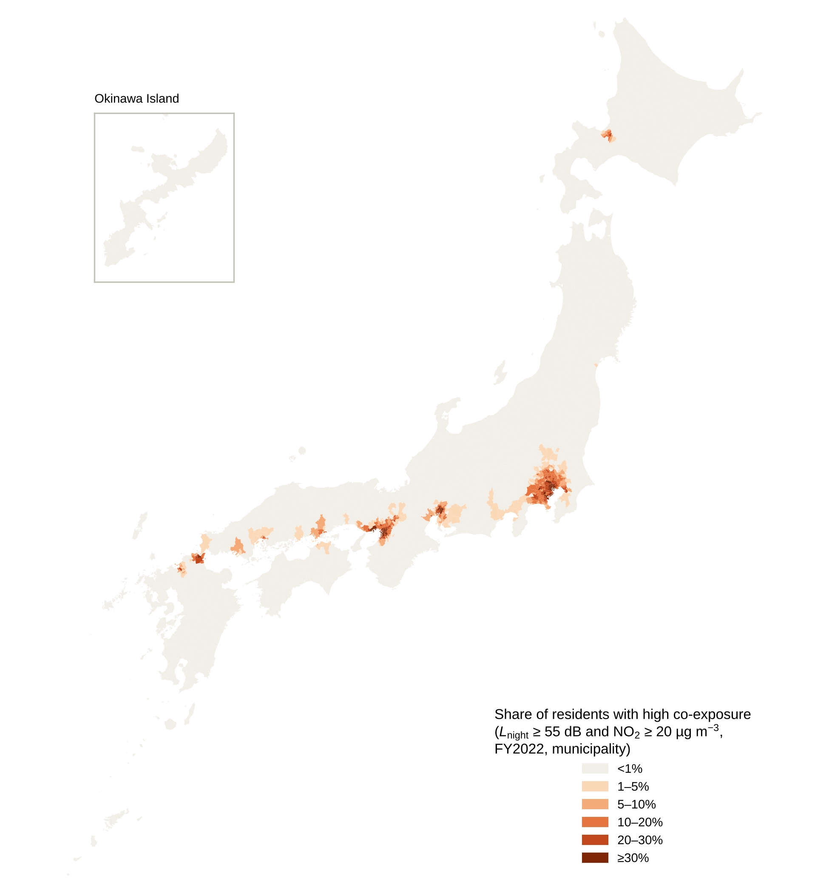

# Nitrogen dioxide and nighttime road traffic noise at 12 million homes in Japan, 2015–2023

Code and estimates for the paper "Diverging trends in nitrogen dioxide and nighttime road traffic noise in Japanese cities" (Daisuke Matsushita, ORCID 0000-0002-6765-9366; submitted). The model estimates the annual mean nitrogen dioxide (NO2) concentration at about 12.3 million residential locations that cover the whole population of Japan, for every fiscal year from 2015 to 2023. It uses only public data: the national Road Traffic Census, the population census, the national air quality monitoring network and a satellite-derived surface NO2 product. The same locations carry the nighttime road traffic noise (Lnight) of the companion model [japan-night-road-noise](https://github.com/m138/japan-night-road-noise), so the two exposures can be compared at the same homes.

<p align="center"></p>

*Share of residents with high co-exposure (Lnight ≥ 55 dB and NO2 ≥ 20 µg/m³, fiscal year 2022) by municipality. Interactive map: https://m138.github.io/japan-traffic-no2/ . Map lines delineate study areas and do not necessarily depict accepted national boundaries. Made by `src/make_readme_map.py`.*

> Status: pre-publication. The paper citation and the Zenodo DOIs will be added when they exist ([ ] below).

## Get the estimates (no need to run the model)
The estimates are deposited in Zenodo ([DOI]) under CC BY 4.0. Most users need only one of these files:

| File | One row per | Use it for |
|---|---|---|
| `small_area_no2_noise_2015_2023.csv` | 2020 census small area (`KEY_CODE`, about 211,000 areas) | Linking to census or health data by small area; mapping |
| `no2_2015_2023_by_municipality.csv` | Municipality (5-digit code) | Planning and policy; municipal comparisons |
| `no2_2015_2023_by_prefecture.csv` | Prefecture | National summaries |
| `receptors_no2_noise_2015_2023.parquet` | Residential location (12.3 million points, lon/lat) | Linking to geocoded cohorts; your own aggregation units |
| `stations_lopo_2015_2023.csv` | Monitoring station and fiscal year | Comparing your own model with ours at the same stations |
| `section_nox_2015_2021.csv` | Road Traffic Census section | A road-by-road NOx emission inventory for Japan |

Column definitions are in `data_dictionary/`. Concentrations are in ppb (1 ppb = 1.88 µg/m³ at 25 °C). `road_YYYY` is the part of NO2 explained by census roads within 1 km; `NO2_YYYY − road_YYYY` is the background.

Example (Python): join small-area NO2 to the e-Stat boundaries.
```python
import geopandas as gpd, pandas as pd
sa = pd.read_csv("small_area_no2_noise_2015_2023.csv", dtype={"KEY_CODE": str})
gdf = gpd.read_file("r2ka27.shp")            # e-Stat 2020 small-area boundaries, Osaka
gdf = gdf[gdf.HCODE == 8101].merge(sa, on="KEY_CODE")
gdf.plot(column="NO2_2023", legend=True)
```

## Accuracy
Leave-one-prefecture-out cross-validation against about 1,600 stations per year: R² 0.78–0.81 (all stations), 0.46–0.60 (roadside stations), RMSE about 2 ppb. In the same test, the 1 km global models of Anenberg et al. (2022) and Cooper et al. (2022) reached R² 0.42–0.43 and almost no skill at roadside stations. The estimates are meant for comparing places and years, not for predicting the concentration at a single address.

## Main results
- From fiscal year 2015 to 2023, measured NO2 fell by 37% at roadside stations, whereas nighttime noise measured along roads fell by only 0.75 dB (figures/fig2.png).
- An estimated 8.9% of residents (11.2 million) had high co-exposure; 70% of them lived in Tokyo's 23 wards and the designated cities, which hold 30% of the population, and 83% within 100 m of a main road (figures/fig3.png).
- NO2 varies mainly between municipalities (92% of the population-weighted variance) and nighttime noise mainly within them (11% between municipalities) (figures/fig4.png).

The summary tables behind the numbers in the paper (key numbers, Table 1, correlations by spatial unit, measured trends, sensitivity analyses) are in `results/` of the Zenodo deposit and are made by `src/release_results.py`. Figures 1–4 of the paper are in `figures/` and are made by `src/make_figures.py`. The interactive map (`docs/`) shows NO2 for each fiscal year, its change, the near-road contribution, nighttime noise and high co-exposure by municipality; `src/make_webmap_data.py` makes its data.

## What the code does
1. Computes NOx emissions for every section of the 2015 and 2021 Road Traffic Census from traffic counts, travel speed and the speed-dependent emission factors of NILIM Technical Note 671 (by calendar year).
2. Places residential locations in the 2020 census small areas (about one per 10 residents, random seed 20261106; points on carriageways removed). These are the same locations as in japan-night-road-noise.
3. Builds predictors at stations and locations: a line-source kernel of nearby road emissions (1 km), emission and population densities at 1–10 km, and TROPOMI-inferred surface NO2 (Cooper et al. 2022).
4. Fits, for each fiscal year, a linear model with Gaussian-process kriging of residuals, cross-validates it by prefecture and predicts at all locations.
5. Computes the night noise of the companion model at the same locations, and summarizes joint exposure, spatial scale and trends.

The order of the scripts and their arguments are in [PIPELINE.md](PIPELINE.md). The inputs and their terms of use are in [DATA_SOURCES.md](DATA_SOURCES.md). A full national run takes several hours on 4 cores and about 16 GB of memory.

## Main limitations
- Only roads in the Road Traffic Census are explicit sources; local roads enter through the background terms.
- Traffic counts exist for two census years (2015, 2021). Changes between them come from emission factors, the yearly model coefficients and kriging of the monitoring data.
- Roadside stations are predicted less well than ambient stations; street-canyon effects and intersections are not modeled.
- Estimates are outdoor values at the location; floor, facade orientation and windows are not considered.

## License
- Code: MIT License (LICENSE)
- Estimates (Zenodo): CC BY 4.0. Please also credit the data sources listed in DATA_SOURCES.md.

## Citation
[Citation of the paper and the Zenodo DOI]
